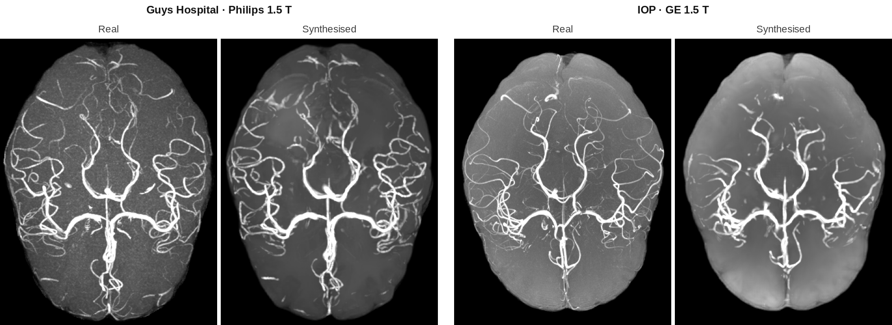
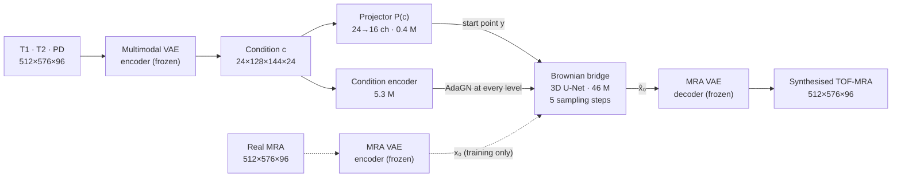

# Topologically constrained latent adversarial diffusion for 3D angiography synthesis

**Generating 3D brain angiography from routine MRI, with no extra scan.**

MSc thesis · FERIT Osijek, 2026 · graded 5/5
Supervised by prof. dr. sc. Irena Galić, co-supervised by Juraj Perić, univ. mag. ing. comp.
*Original title: "Topološki ograničena latentna suparnička difuzija za sintezu 3D angiografije"*


<p align="center">
  
  <br><sub>Maximum intensity projections of two <b>test-set</b> subjects. The synthesised volumes were generated from T1, T2 and PD only.</sub>
</p>

## 🩺 The problem

**TOF-MRA** (time-of-flight MR angiography) shows the brain's arteries. A 3D TOF-MRA scan takes several minutes, and any patient movement during it lowers image quality. T1, T2 and PD scans, by contrast, are part of almost every brain MRI exam. This project **synthesises the 3D TOF-MRA from the T1, T2 and PD scans** the patient already has.

**Why it's hard:**
- Vessels fill only **about 1% of the volume** (3.2% of brain voxels).
- L1 and L2 losses treat every voxel the same, so a model learns the shape of the brain and leaves the vessels out.
- PSNR and SSIM can stay high even when no vessels are present at all.
- Vessels break apart easily. That's why the project uses a topology loss and measures connectivity with Betti numbers.

## 🧠 How it works



1. **Two 3D autoencoders.**
   - The MRA VAE compresses each volume 4× along every axis, giving 64× fewer spatial positions with 16 channels. It still keeps the vessels: Dice 0.948 after encoding and decoding.
   - The multimodal VAE encodes T1, T2 and PD into 3 × 8 channels, which serve as the condition.
2. **A Brownian-bridge diffusion model** runs in the latent space. Standard diffusion starts from pure noise. Here, the bridge starts from the projector's estimate `y = P(c)` and travels to the target, so **5 deterministic steps** are enough (T = 1000).
3. **Vessel-focused losses.**
   - The network predicts `xₜ − x₀`.
   - Frangi vesselness maps make errors on vessels count up to **9×** more.
   - Losses on `x̂₀` are applied only away from the bridge's end point. Near the end point, `x₀` is determined by the condition alone, so the model would just learn an average.
4. **Fine-tuning branches.** All branches start from the same base model, epoch 170. The options tested were:
   - **Topology:** soft clDice, which compares vessel skeletons and penalises breaks, paired with soft Dice, which penalises excess voxels.
   - **Adversarial:** a 2D PatchGAN on maximum intensity projections.

## 📊 Results

Epochs, branches and step counts were chosen on the validation set only (57 volumes). The test set (**56 volumes from 3 hospitals**) was evaluated **once**, for all models at the same time, with the same seed.

| Model | Vessel Dice | clDice | Vessel volume ratio | Precision | b1 error | PSNR [dB] |
|---|:-:|:-:|:-:|:-:|:-:|:-:|
| *MRA VAE reconstruction (upper bound)* | *0.948* | *0.932* | *0.98* | *0.959* | *4.5* | *49.7* |
| Projector only, no diffusion | 0.034 | 0.027 | 0.09 | 0.630 | 55.1 | 28.38 |
| Brownian bridge (base model) | 0.248 | 0.160 | 0.63 | **0.416** | 39.6 | **28.71** |
| + clDice | 0.278 | **0.296** | 1.63 | 0.247 | 32.8 | 28.13 |
| **+ clDice and soft Dice** | **0.278** | 0.225 | **0.96** | 0.339 | 35.6 | 28.46 |
| + adversarial loss | 0.256 | 0.224 | 1.80 | 0.251 | **28.6** | 27.62 |
| + clDice, soft Dice and adversarial | 0.278 | 0.233 | 1.19 | 0.308 | 29.9 | 27.99 |
| Final model (clDice + soft Dice, stronger vessel losses) | 0.270 | 0.207 | 0.87 | 0.360 | 36.9 | 28.56 |

<sub>**Vessel volume ratio** is the number of vessel voxels in the synthesis divided by the number in the reference. 1.0 is correct, and above 1 means vessels are too thick. **b1 error** is the error in the number of independent loops in the vessel network; the reference has 55.1.</sub>

### What the results show

1. **The reverse bridge process is what creates the vessels.**
   - The projector alone reaches a vessel Dice of 0.034 and has no component above the vessel threshold.
   - After the bridge, Dice is 0.248. FID drops from 4.50 to 0.085.
   - Meanwhile PSNR changes by only **0.33 dB**: standard image metrics barely tell a volume with vessels apart from one without.
2. **The topology loss only helps when it's paired with a counterweight.**
   - clDice alone gets the highest clDice by **thickening the vessels**, to a volume ratio of 1.63 with precision falling to 0.247.
   - Paired with soft Dice, Dice rises to 0.278 (better in **52 of 56** volumes) and the volume ratio is 0.96. The b1 error also falls from 39.6 to 35.6.
3. **Adversarial loss isn't used in the final model.** It was tested on both the autoencoder and the diffusion model. In both cases it thickened structures and lowered fidelity: −1.09 dB PSNR and a volume ratio of 1.80.
4. **PSNR and SSIM aren't enough on their own.** Judging this task also takes Dice, clDice, vessel volume ratio, precision, Betti numbers and visual inspection.

### Where the error comes from

| Stage | Finding |
|---|---|
| Compression | The autoencoder keeps almost the whole vessel network (Dice **0.948**, Betti errors 2.1 / 4.5). |
| Latent sensitivity | Gaussian noise with std 0.25 in the latent drops Dice to **0.59**. |
| Model error | An error of the same size from the diffusion model drops Dice about **2× more**, because it is concentrated on vessels. |

So the small vessels are lost **during diffusion, not during compression**. The latent space keeps the vascular information, but stores it in a way where small errors cost a lot.

### Limitations
- **Fine peripheral vessels and junctions go missing.** The final model has 21 loops against 55 in the reference.
- **The topology loss sees only 16 of 96 slices.** It is computed on 128 × 144 × 4 latent slabs, which is 512 × 576 × 16 voxels after decoding.
- **Hardware limits:** a batch size of 1 on a single 16 GB GPU.
- **Narrow data:** only the IXI dataset and only healthy subjects, with no external comparison on the same protocol.

**Future work:**
- a topology loss over a larger extent, using activation recomputation and slabs in three orientations
- a separate objective for the number of components (b0)
- pixel-space diffusion as an independent check
- an external dataset with intensity harmonisation

## 🗂️ Data

The data is **IXI**: 568 paired subjects from three London hospitals, split 80/10/10 by subject and stratified by hospital.

| Hospital (scanner) | Train | Val | Test |
|---|:-:|:-:|:-:|
| Guys (Philips 1.5 T) | 252 | 32 | 31 |
| HH (Philips 3 T) | 145 | 18 | 18 |
| IOP (GE 1.5 T) | 58 | 7 | 7 |
| **Total** | **455** | **57** | **56** |

**Preprocessing steps:**
1. pairing by file name
2. LPS+ reorientation
3. SynthStrip skull-stripping
4. resampling the MRA to 0.4 × 0.4 × 0.8 mm
5. resampling T1, T2 and PD onto the MRA grid
6. intensity normalisation
7. padding or cropping to 512 × 576 × 96

## ✨ Engineering highlights
- **Full pipeline in one repo.** It covers raw IXI NIfTI files through preprocessing, both VAEs, the latent bridge, the fine-tuning branches and the evaluation, which includes Betti numbers and per-site breakdowns.
- **Reproducible.** Every table and figure in the thesis is regenerated by a single script in `analysis/` or `figures/`. Dependencies are locked with `uv`.
- **Safe to experiment.** Training scripts refuse to overwrite the checkpoints and test results that the thesis reports. Every trainer has a `--smoke` mode.
- **Tested.** 94 pytest tests cover the models, losses, metrics, preprocessing and the protection of thesis artefacts.

**Training details:**
- **Base model:** AdamW at lr 10⁻⁴, batch size 1, bfloat16, EMA 0.999. It trained for 340 epochs (15 h) on an RTX 5080, and epoch 170 was selected by Dice.
- **Fine-tuning:** the projector is frozen, lr is 2 · 10⁻⁵, and each branch trains for 10–40 epochs.

Step-by-step settings, expected numbers, checks and troubleshooting for every training stage are in **[Instructions.md](Instructions.md)**. The rest of this file is the map and the command list.

---

## 1. Setup

Requirements: Python 3.12, an NVIDIA GPU with at least 16 GB (developed on an RTX 5080), and
[uv](https://docs.astral.sh/uv/).

```bash
uv sync
```

This installs the exact versions in `uv.lock`, the environment the thesis results came from
(torch 2.10 + CUDA 13.0 from the PyTorch index). **Run every command from the repository
root.**

External weights, not in git:

| file | source | location |
|---|---|---|
| `synthstrip.1.pt` | [SynthStrip](https://surfer.nmr.mgh.harvard.edu/docs/synthstrip/) | `third_party/synthstrip/` |
| `resnet_10_23dataset.pth` and `models/resnet.py` | [Tencent/MedicalNet](https://github.com/Tencent/MedicalNet) | `third_party/MedicalNet/` (FID only) |

## 2. Layout

```
preprocess.py             raw IXI NIfTI -> Dataset/Cropped
split_dataset.py          -> Dataset/splits (manifest) + Dataset/split_numpy/{train,val,test}
train_vae_multimodal.py   T1/T2/PD autoencoder (the condition)
train_vae_mra.py          MRA autoencoder v4
finetune_vae_mra.py       v4 -> v5 arms: cldice / adv / both
export_latents.py         --model mra | multimodal
make_frangi_weights.py    Frangi vessel weights at latent resolution
make_vessel_bands.py      per-case vessel band for the clDice loss
train_bbdm.py             Brownian-bridge diffusion model
finetune_bbdm.py          arms: cldice_alone / cldice / adv_alone / both / delivered
evaluate.py               Tables 5.3 and 5.4 (bridge, all arms, Betti numbers, per site)
evaluate_vae.py           MRA VAE acceptance metrics

modules/      library code, never run directly
  paths.py            repository paths, case helpers, protection of thesis artefacts
  preprocessing.py    reorientation, SynthStrip, resampling, normalisation, cropping
  split.py            site-stratified split and .npy conversion
  frangi.py           Frangi vesselness weights
  vae_multimodal.py   multimodal VAE: model, patch dataset, loss, training loop, encoding
  vae_mra.py          MRA VAE v4/v5: model, tiling, crop dataset, losses, evaluation
  latent_data.py      paired latent dataset and per-channel standardisation
  unet.py             conditional AdaGN 3D UNet
  bridge.py           Brownian bridge, projector, validation
  losses.py           vessel-weighted latent losses
  topology.py         soft skeleton, clDice, soft Dice, vessel probability
  adversarial.py      3D patch and MIP discriminators, hinge losses, adaptive weight
  metrics.py          masked SSIM/PSNR, MIP SSIM, vessel Dice, clDice, Betti numbers
configs/      preprocess.json, vae_multimodal.json, frangi.json, bbdm.json
analysis/     the other thesis numbers (Tables 5.1/5.2, FID, IOP, bridge steps)
figures/      one script per thesis figure
tests/        pytest
```

## 3. Thesis artefacts are protected

These hold the results the thesis reports. Every training and export script refuses to write
into them:

| path | what |
|---|---|
| `checkpoints/vaev2_multimodal/kl5e5_from_epoch10/best.pt` | multimodal VAE (epoch 75) |
| `checkpoints/vaev4_mra/v4_c16_fixed/best.pt` | MRA VAE v4 |
| `checkpoints/vaev5_mra/v5_{cldice,adv,both}/best.pt` | MRA VAE v5 arms; `v5_cldice` is used everywhere |
| `checkpoints/ldm_bbdm/best.pt` | base bridge (epoch 170) and its arms `ft_*`, `both_ep10_assessed.pt` |
| `checkpoints/ldm_bbdm_vessel/ft_cldice/best.pt` | **the delivered model** |
| `latents/{T1,T2,PD}` | conditioning latents, a **fixed input**  |
| `latents_v5_cldice/` | MRA target latents (the export reproduces them bit-for-bit) |
| `runs/table53_test/` | the test-set results of Tables 5.3 and 5.4 |

## 4. Pipeline

Run `--smoke` before any long run; smoke runs write only to `checkpoints/_smoke`. Times are
for one RTX 5080.

### 4.1 Data

1. Download IXI T1, T2, PD and MRA into `Dataset/Quadruplets/{T1,T2,PD,MRA}/`.
   **Keep an untouched copy elsewhere**: the first two steps delete incomplete cases and
   reorient files in place.
2. Preprocess and split:

```bash
uv run preprocess.py
uv run split_dataset.py
```

### 4.2 Multimodal VAE (condition)

About 23 h.

```bash
uv run train_vae_multimodal.py --smoke
uv run train_vae_multimodal.py
uv run export_latents.py --model multimodal --checkpoint checkpoints/rebuild/vae_multimodal/multimodal_rebuild/best.pt
```

### 4.3 MRA VAE (target)

About 9 h for v4, plus 30 epochs per v5 arm.

```bash
uv run train_vae_mra.py --smoke
uv run train_vae_mra.py
uv run finetune_vae_mra.py --checkpoint checkpoints/rebuild/vae_mra/v4_c16/best.pt --arms cldice adv both -n 30
uv run export_latents.py --checkpoint checkpoints/rebuild/vae_mra_v5/v5_cldice/best.pt --out latents_rebuild_v5
```

### 4.4 Loss inputs

```bash
uv run make_frangi_weights.py
uv run make_vessel_bands.py
```

### 4.5 Brownian bridge

About 15 h. The thesis model peaked at epoch 170.

```bash
uv run train_bbdm.py --sanity 5 --scratch
uv run train_bbdm.py
```

`configs/bbdm.json` reads the thesis latents and VAE. For a full rebuild, point
`data.target_root`, `data.conditioning_root` and `vae.checkpoint` at your own outputs.

### 4.6 Fine-tuning arms

40 epochs each, about 2.5 h per arm.

```bash
uv run finetune_bbdm.py --arms cldice --smoke --scratch
uv run finetune_bbdm.py --arms cldice_alone cldice adv_alone both -n 40
uv run finetune_bbdm.py --arms delivered -n 40
```

By default the arms start from the thesis base bridge; pass `--checkpoint` for your own.

### 4.7 Evaluation

Validation first; the test split is used once:

```bash
uv run evaluate.py --split val --cases 4 --models vae isporuceni
uv run evaluate.py --split test --out runs/table53_test_rerun
uv run evaluate_vae.py --split val
```

The other thesis numbers and all figures come from scripts without arguments:

```bash
uv run analysis/vae_arms.py            # Table 5.1: VAE arms on all 57 validation volumes
uv run analysis/multimodal_metrics.py  # Table 5.2: multimodal VAE SSIM / PSNR per modality
uv run analysis/vae_mip_psnr.py        # MIP PSNR of the MRA VAE
uv run analysis/vae_site_iop.py        # MRA VAE on the IOP cases only
uv run analysis/vae_fid.py             # MedicalNet FID, validation split
uv run analysis/bridge_steps.py        # number of bridge steps
uv run figures/fig_modalities.py       # Figure 3.1   (all figures -> runs/figures, runs/step_previews)
uv run figures/fig_architecture.py
uv run figures/fig_forward_process.py
uv run figures/fig_multimodal_vae.py   # Figure 5.1
uv run figures/fig_results.py
uv run figures/fig_test_synthesis.py   # Section 5.4, test split
uv run figures/fig_bridge_steps.py
uv run figures/fig_eta.py
```

## 5. Tests

```bash
uv run pytest
```

94 tests cover the models, losses, metrics, Frangi weights, preprocessing and the protection
of thesis folders, plus `--help` for every script. Tests that need the local thesis
checkpoints skip themselves when those are absent.
